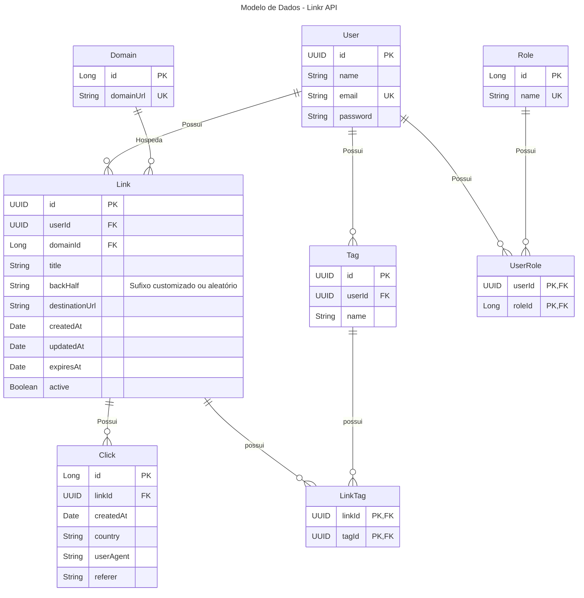

# Linkr API 🔗


O **Linkr API** é um serviço robusto de encurtamento e gerenciamento de URLs desenvolvido em Java e Spring Boot como projeto pessoal. O sistema foi construído trazendo recursos avançados como controle de acesso baseado em funções (RBAC), gerenciamento de domínios personalizados, categorização de links por tags, rastreamento analítico de cliques e um módulo futuro para geração de QR Codes com armazenamento em S3/MinIO.

## 🚀 Tecnologias Utilizadas

### Core & Backend

* **Java 25**: Utilização do recurso de Virtual Threads para alta concorrência.
* **Spring Boot 4.x (4.1.1)**:
  * **Spring Data JPA / Hibernate**: Persistência de dados e mapeamento relacional.
  * **Spring Security**: Autenticação stateless e controle de permissões por roles (`ROLE_USER`, `ROLE_ADMIN`).
  * **Spring Boot Validation**: Validação rigorosa de payloads de requisição.
  * **Spring WebMVC**: Criação da API RESTful.
* **jjwt (0.13.0)**: Emissão e validação de tokens JWT para autenticação.
* **Lombok**: Redução de código boilerplate em entidades e DTOs.

### Banco de Dados & Migrações

* **PostgreSQL 18**: Banco de dados relacional padrão da aplicação.
* **Flyway**: Gerenciamento e versionamento de migrações do banco de dados (`V1`, `V2`, etc.).

### Infraestrutura & Servidor Web

* **Caddy**: Servidor web e proxy reverso para gerenciamento de tráfego e SSL/TLS automático.
* **Docker & Docker Compose**: Conteinerização do banco de dados PostgreSQL e do ambiente de execução da API.

### Armazenamento de Objetos (Módulo Futuro)

* **AWS S3 / MinIO**: Armazenamento dos arquivos de imagem dos QR Codes gerados para os links encurtados.

### Documentação

* **SpringDoc OpenAPI / Swagger UI**: Documentação interativa e testes de endpoints da API REST.

## 📊 Modelo de Dados

O modelo relacional do sistema contempla usuários, funções, domínios, links encurtados, tags e histórico detalhado de cliques.



## 📌 Status do Projeto & Roadmap

### Fase 1: Módulo Base e Autenticação 🟢 (Concluído)

- [x] Configuração inicial do projeto Spring Boot com Java 25.
- [x] Configuração do ambiente Docker com PostgreSQL 18 e `compose.yml`.
- [x] Criação e padronização dos scripts Flyway (`V1__init_migration.sql` e `V2__standardize_entity_id_types.sql`).
- [x] Estruturação da segurança com Spring Security e autenticação JWT (`/v1/auth/register`, `/v1/auth/login`).
- [x] Implementação dos modelos e repositórios core (`UserEntity`, `RolesEntity`, `DomainEntity`, `LinkEntity`, `TagEntity`, `ClickEntity`).
- [x] CRUD de gerenciamento de Domínios (`/v1/domain`) restrito a administradores.

### Fase 2: Encurtador de Links & Redirecionamento 🟡 (Em Progresso)

- [ ] Implementação do serviço de geração de `backHalf` (sufixo do link) aleatório e validação de sufixo customizado.
- [ ] Endpoint de criação de links encurtados com suporte a expiração (`expiresAt`) e tags.
- [ ] Endpoint de redirecionamento HTTP 302 / 301 com registro assíncrono de cliques (`ClickEntity`: país, User-Agent, Referer).
- [ ] Painel/Endpoints de métricas e analytics por link encurtado.
- [ ] Configuração do Caddy como Proxy Reverso e gerenciador de domínio.

### Fase 3: Módulo de QR Code & Armazenamento em Nuvem 🔴 (Planejado)

- [ ] Integração com AWS SDK / MinIO Client.
- [ ] Serviço de geração automática de imagem de QR Code para novos links ou sob demanda.
- [ ] Armazenamento do PNG/SVG do QR Code no bucket S3/MinIO e retorno da URL pública no DTO de resposta.
- [ ] Ajuste no painel/endpoints para download e gestão do QR Code.

## 🛠️ Como Executar o Projeto

### Pré-requisitos

* **Java 25** instalado.
* **Maven 3.9+** (ou utilizar o `./mvnw` incluso).
* **Docker** e **Docker Compose** instalados e em execução.

### 1. Clonar o repositório

```bash
git clone https://github.com/williiansilva51/linkr-api.git
cd linkr-api
```

### 2. Subir o banco de dados PostgreSQL

```bash
docker compose up -d postgres
```

### 3. Configurar variáveis de ambiente

As configurações padrão estão definidas em `src/main/resources/application.yaml`. Para substituir os valores no ambiente de desenvolvimento, você pode definir as variáveis:

* `DATABASE_URL`: `jdbc:postgresql://localhost:5432/linkr`
* `DATABASE_USERNAME`: `linkr`
* `DATABASE_PASSWORD`: `CHANGEME`
* `JWT_SECRET`: Sua chave secreta JWT (mínimo 256 bits)

### 4. Compilar e executar a aplicação

```bash
./mvnw spring-boot:run
```

A aplicação estará acessível em `http://localhost:8080/api`.

## 📖 Documentação da API

Quando a aplicação estiver em execução, a documentação Swagger UI / OpenAPI pode ser acessada através do navegador:

* **Swagger UI**: `http://localhost:8080/docs` ou `http://localhost:8080/swagger-ui/index.html`
* **OpenAPI Docs**: `http://localhost:8080/v3/api-docs`

## 👨‍💻 Autor

Desenvolvido por **Willian Silva** ([antonio.willian051@gmail.com](mailto:antonio.willian051@gmail.com)).
